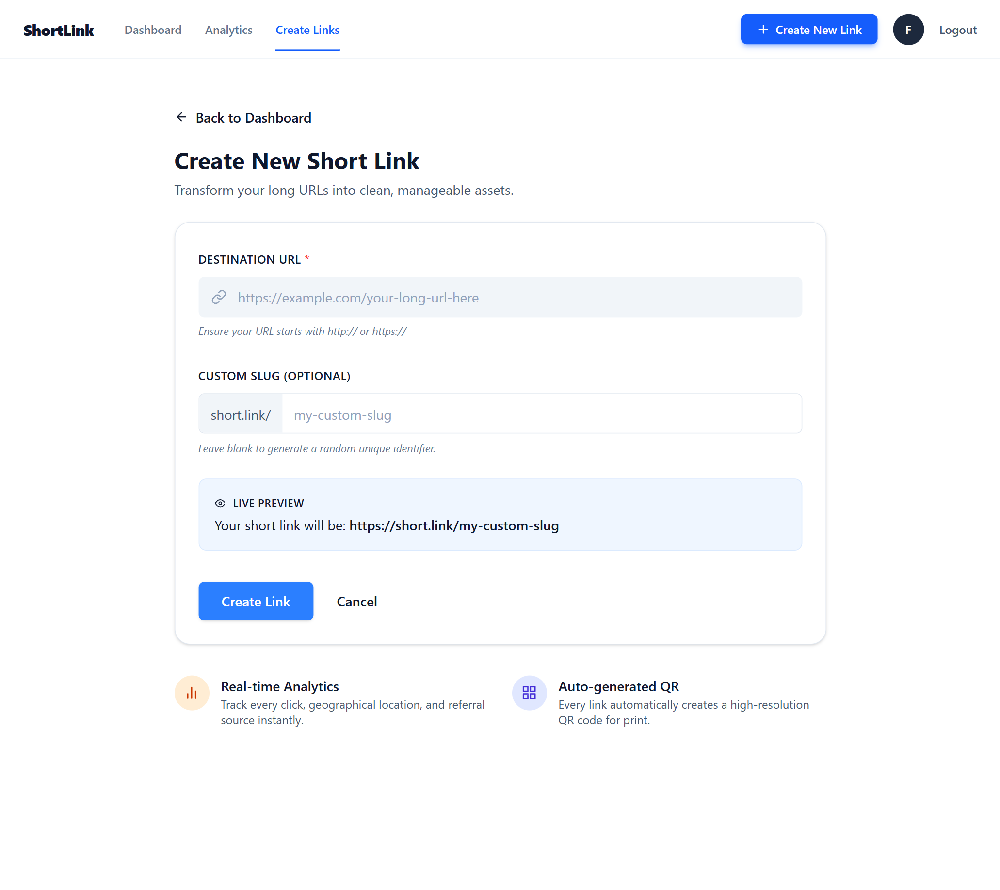
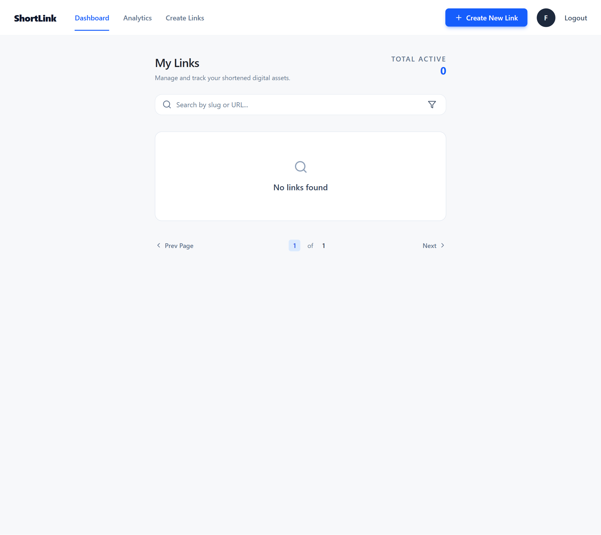
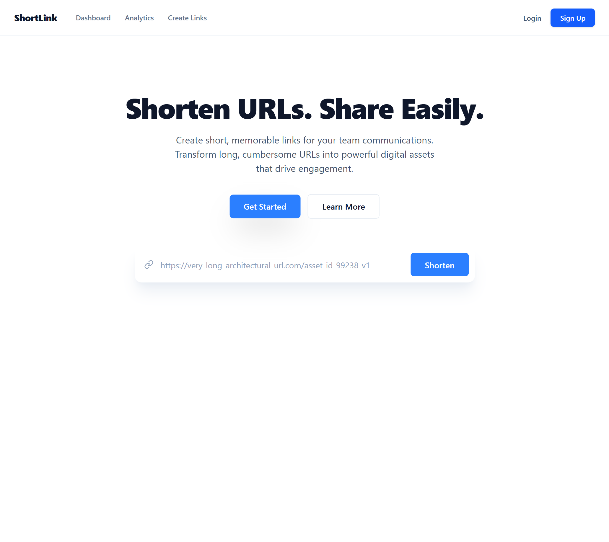
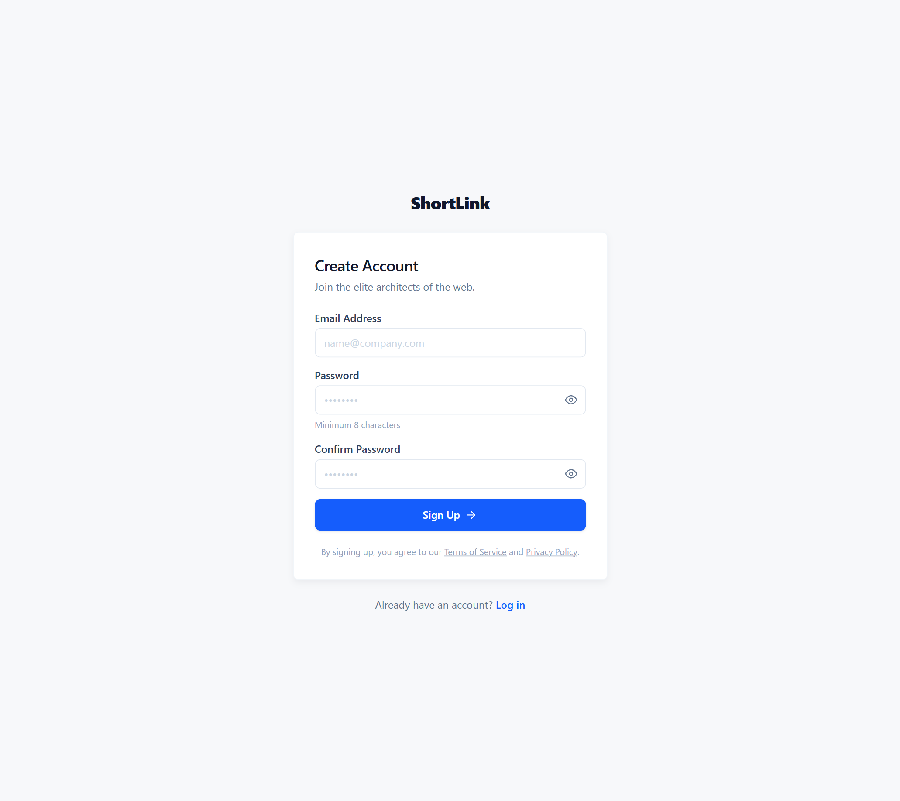
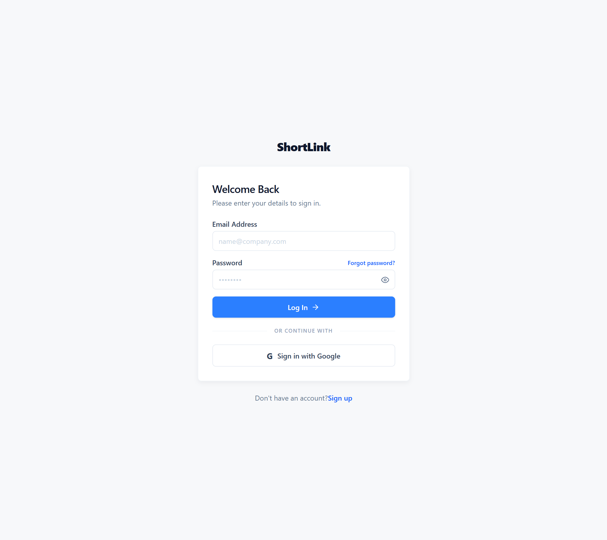

# Frontend Shortlink

A URL shortener web application that allows users to convert long URLs into shorter, more manageable links. Built with React and Vite, this application provides a responsive user interface, form validation, and centralized state management.

## Tech Stack


## Features

- Shorten long URLs into compact links.
- Create custom slugs, if supported by the backend.
- View and manage shortened URLs.
- Search and filter links.
- Copy shortened URLs to the clipboard.
- Form validation with React Hook Form.
- Global state management with Redux Toolkit.
- Client-side routing with React Router.
- Responsive user interface with Tailwind CSS.

*Feature availability depends on the implemented frontend functionality and backend API.*

## Preview Pages 






## Prerequisites

Make sure the following tools are installed on your machine:

- [Node.js](https://nodejs.org/)
- npm (included with Node.js)
- [Git](https://git-scm.com/) (optional, for cloning the repository)

Verify your installation:

```bash
node -v
npm -v
```

## Getting Started

### 1. Clone the Repository

```bash
git clone <YOUR_REPOSITORY_URL>
```

Navigate to the project directory:

```bash
cd frontend-shortlink
```

Replace `<YOUR_REPOSITORY_URL>` with your actual repository URL.

### 2. Install Dependencies

```bash
npm install
```

This command installs the project dependencies listed in `package.json`.

### 3. Configure the Backend API

Set the backend API base URL in a dedicated configuration file.

For example, create `src/config/api.js`:

```javascript
export const API_URL = "http://localhost:8080";
```

Use this constant when making API requests:

```javascript
import { API_URL } from "../config/api";

const response = await fetch(`${API_URL}/your-endpoint`);
```

Replace the example URL and endpoint with the actual backend address and API route.

**Note:** This project does not use `import.meta.env.VITE_API_URL`.

### 4. Start the Development Server

```bash
npm run dev
```

Vite will display the local development URL in your terminal, usually:

```text
http://localhost:5173
```

Open the URL in your browser to access the application.

## Available Scripts

| Command | Description |
|---|---|
| `npm run dev` | Starts the development server. |
| `npm run build` | Builds the application for production. |
| `npm run preview` | Previews the production build locally. |

## Project Structure

The following is an example of the project structure:

```text
frontend-shortlink/
├── public/
├── src/
│   ├── assets/
│   ├── components/
│   ├── features/
│   ├── hooks/
│   ├── layouts/
│   ├── pages/
│   ├── routes/
│   ├── services/
│   ├── store/
│   ├── config/
│   ├── App.jsx
│   ├── main.jsx
│   └── index.css
├── .gitignore
├── eslint.config.js
├── index.html
├── package.json
├── package-lock.json
└── vite.config.js
```

Adjust the directory structure to match the actual implementation.

## Production Build

Generate an optimized production build:

```bash
npm run build
```

The build output will be generated in the `dist/` directory.

To preview the production build locally:

```bash
npm run preview
```


## Backend Integration

This repository contains the frontend application. Backend operations, database management, URL redirection, and API processing are handled by the backend service.

Ensure the backend server is running and the API base URL is configured correctly before testing features that require backend connectivity.

## License

No license has been specified yet. Add a `LICENSE` file if you intend to distribute this project under an open-source license.
